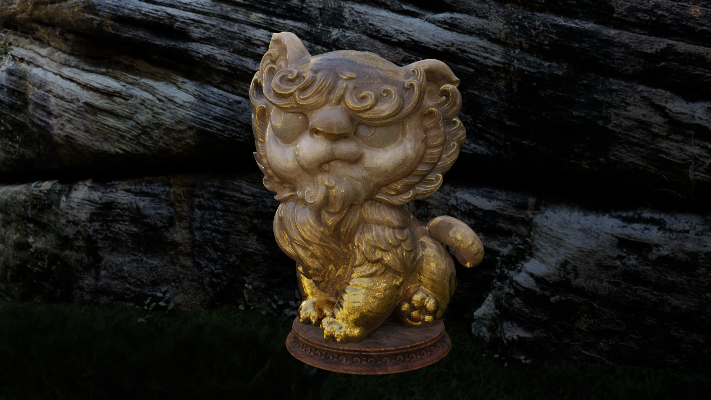
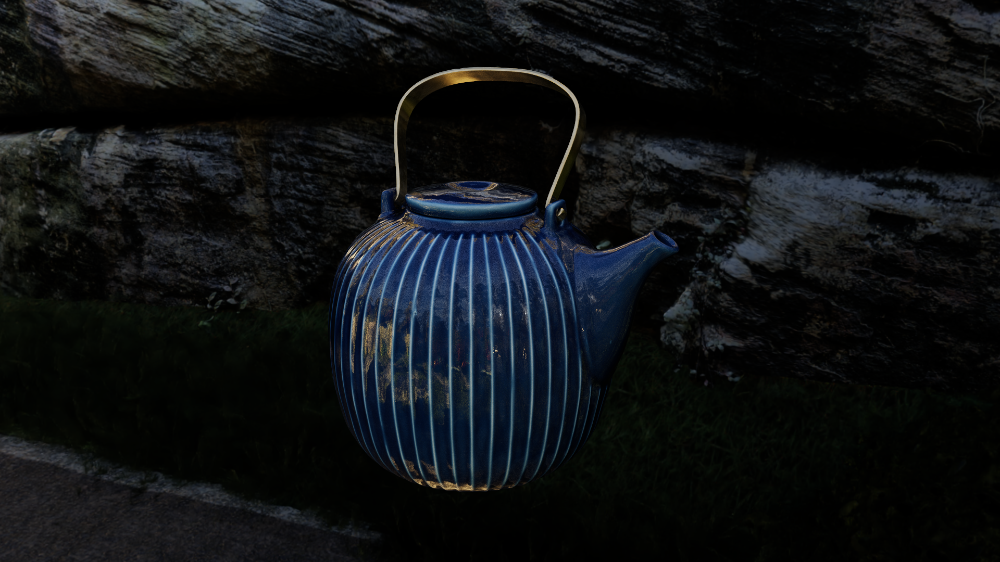
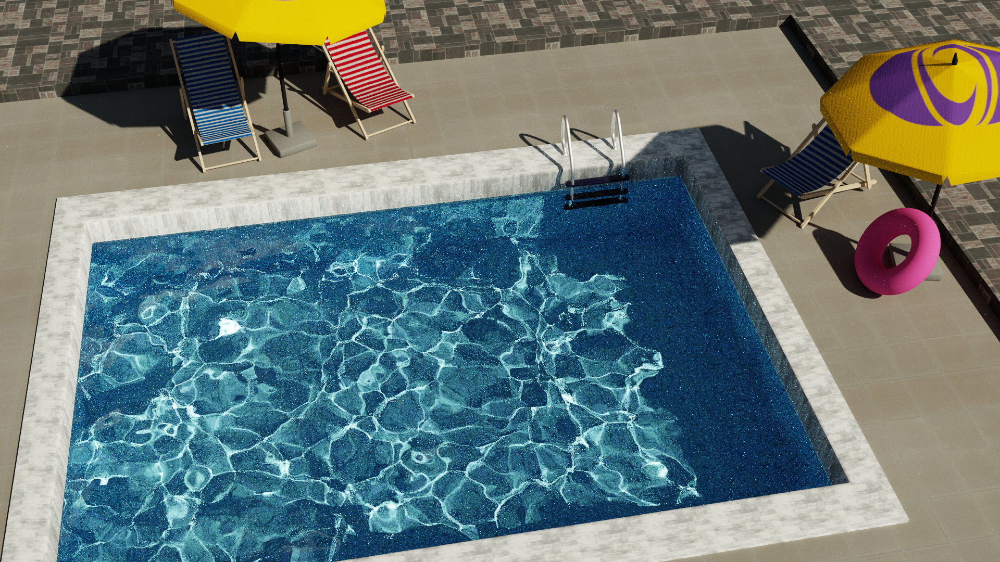
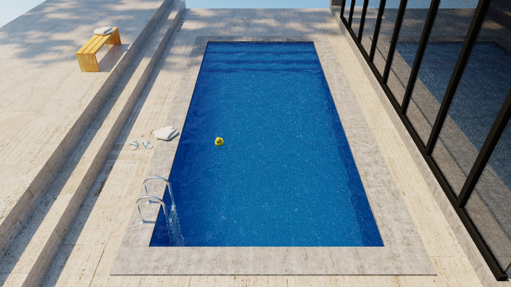
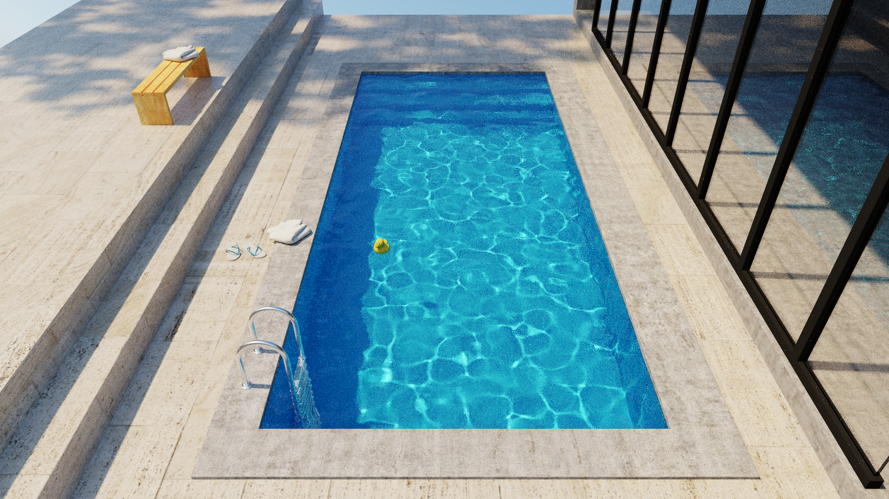

A physically based CUDA and OptiX path tracer for USD.

## Gallery

### MaterialX Lion



[Asset and credits](https://dpel.aswf.io/materialx-teapot-lion/)[^materialx-alab].

### MaterialX Teapot



[Asset and credits](https://dpel.aswf.io/materialx-teapot-lion/)[^materialx-alab].

### Swimming Pool



[Scene source and credits](https://github.com/tizian/specular-manifold-sampling/tree/master/results/Figure_14_15_MainComparison).

## Features:

### MaterialX Graph Evaluation
MaterialX is a standard for sharing materials across different 
DCCs and renderers. It uses node graphs to represent BSDF closures, where each 
node represents a particular operation, such as texturing, arithmetic, blending, or color 
adjustment. MaterialX also supports creating layered BSDFs with node graphs and contains 
base implementations for common BSDFs such as conductors, dielectrics, and sheen. 
Artists can freely combine these nodes to create a wide range of materials.

Yeoubi renders MaterialX graphs by compiling headers at runtime for each material. Each 
header implements a single node and uses macros to access its inputs. Four kernels 
are compiled per material: closure initialization, sampling, evaluation, and pdf calculation.
Each material is compiled by traversing its node graph in topological order, 
defining the input macros, and generating the final source. The kernels are executed at 
runtime by using OptiX's direct callables feature.

Currently only a subset of the MaterialX nodes are implemented.

### Path Guiding
Path guiding is a variance reduction technique that improves the efficiency of Monte Carlo rendering.
In a standard path tracer, samples are often generated using a combination of BSDF sampling 
and direct light sampling, also known as next event estimation (NEE).
While these techniques work well in simple scenes, they can struggle to sample complex effects 
such as caustics and long indirect illumination. 

Path guiding helps address this issue by learning an approximation of the scene's radiance distribution, which is then sampled 
to guide paths towards directions with higher expected contributions.

Yeoubi's implementation of path guiding has the following components:
- A breadth-first kd-tree builder designed for GPU execution
- A CUDA port of OpenPGL's[^openpgl] mixture fitting code[^ruppert]
- Recording training samples in a wavefront renderer[^wavefront]
- Illumination aware spatial subdivision[^subdivision]
- RIS-based guided sampling[^ris]

**Results**

PBRT pool scene rendered at 1920 × 1080, 64 samples per pixel.

| No path guiding | Path guiding with lookahead |
| --- | --- |
|  |  |

This scene contains caustics on the pool floor, which arise from sunlight refracting through 
the surface of the pool. The caustics are clearly visible once path guiding is enabled.

Enable path guiding when configuring the build:
```bash
cmake -S . -B build -DYBI_ENABLE_PATH_GUIDING=ON
```

[^materialx-alab]: [MaterialX Teapot and Lion license](licenses/MaterialX-Teapot-and-Lion.txt).
Lighting uses the Netflix Animation Studios ALab environment map. 
[Netflix Animation Studios ALab license](licenses/Netflix-Animation-Studios-ALab.txt).

[^openpgl]: Sebastian Herholz and Addis Dittebrandt. 2022.
    [Intel® Open Path Guiding Library](https://github.com/OpenPathGuidingLibrary/openpgl).

[^wavefront]: Lea Reichardt, Brian Green, Yining Karl Li, and Marco Manzi. 2025.
    [Path Guiding Surfaces and Volumes in Disney's Hyperion Renderer: A Case Study](https://www.yiningkarlli.com/projects/pathguidingcourse2025.html).
    In *ACM SIGGRAPH 2025 Course Notes: Path Guiding in Production and Recent Advancements*. 30–66.

[^ruppert]: Lukas Ruppert, Sebastian Herholz, and Hendrik P. A. Lensch. 2020.
    [Robust Fitting of Parallax-Aware Mixtures for Path Guiding](https://doi.org/10.1145/3386569.3392421).
    *ACM Transactions on Graphics* 39, 4 (Jul. 2020), Article 147.

[^subdivision]: Fengshi Zheng, Christoph Peters, Sebastian Herholz, Marco Manzi, and Elmar Eisemann. 2026.
    [Illumination-Aware Spatial Subdivision for Path Guiding](https://studios.disneyresearch.com/2026/07/01/illumination-aware-spatial-subdivision-for-path-guiding/).
    In *Eurographics Symposium on Rendering (EGSR 2026)*.

[^ris]: Sebastian Herholz. 2025.
    [Integrating Path Guiding into a Production Render: The Nitty Gritty Details](https://sherholz.github.io/siggraph2025-path-guiding-course/).
    In *ACM SIGGRAPH 2025 Course Notes: Path Guiding in Production and Recent Advancements*. 4–29, Section 3.3.
